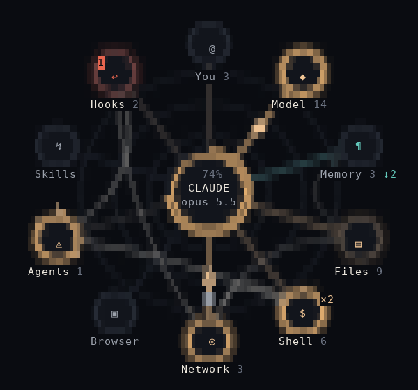

# workmap

workmap began as [lot-map](https://github.com/alexeyw/lot-map), by Aleksei Volodin, under the MIT licence, and carries on from its 0.12.0 under its own name.

> **To do, eventually:** detach this repository from the `alexeyw/lot-map` fork network (GitHub Support, "detach a fork"). Until then GitHub lists it as a fork, and commits here don't count toward the owner's contribution graph. Nothing else depends on it.

A mod for Claude Code: a live map of the work, in a pane beside the chat. Every tool call, model step, hook and skill sends a pulse from the centre to its station, so you see memory, files, shell, web and agents at work instead of reading a list of commands.


_A made-up session replayed through the mod's own drawing code. [Video (MP4)](docs/demo.mp4)._

## Install

At the prompt of a terminal session:

```
/plugin install workmap --marketplace dgfisher2021/workmap
```

Answer `y` to add the marketplace, then choose a scope. From a shell:

```bash
claude plugin install workmap --marketplace dgfisher2021/workmap
```

In the desktop app: click **+** next to the prompt box, then **Plugins**, **Add marketplace** with `dgfisher2021/workmap`, then **Add plugin**.

The pane opens by itself when a session starts; in Windows Terminal from WSL the map is [a window of its own](#a-window-of-its-own) instead. In a terminal the pane needs at least 144 columns; otherwise type `/workmap`. A terminal draws the same map in coloured cells, moving as it does in the app: see [In a terminal](#in-a-terminal). Built and tested on Claude Code 2.1.321 on macOS; users report it working on Windows as well. The terminal map is tested on 2.1.322.

## Updating

From a shell:

```bash
claude plugin marketplace update workmap
claude plugin update workmap@workmap
```

Then start a new session. The first command is needed: without it the second one reports the installed version as the latest.

What each version changed is in [CHANGELOG.md](CHANGELOG.md).

### Moving from lot-map

workmap is a new plugin id (`workmap@workmap`), so an installed lot-map does not update into it. From a shell:

```bash
claude plugin uninstall lot-map@lot-map
claude plugin marketplace remove lot-map
claude plugin install workmap --marketplace dgfisher2021/workmap
```

Then set your options again, since they are kept under the plugin's id (see [Options](#options)), and start a new session. The last model used in each folder is forgotten once, which is harmless. The command is `/workmap`; `/lot-map` is gone.

## What lights up

| Station      | When                                                                                                                                                                                                                                       |
| ------------ | ------------------------------------------------------------------------------------------------------------------------------------------------------------------------------------------------------------------------------------------ |
| User         | your messages, questions and files sent to you, the task list, the plan, and what you are asked to approve                                                                                                                                 |
| Model        | each model request, context compaction                                                                                                                                                                                                     |
| Memory       | Claude Code's memory folder, plus whatever you name in the options                                                                                                                                                                         |
| Files        | Read, Write, Edit, Grep, Glob, a language server's code intelligence, and shell commands that work on files and nothing else: they read, search, move, delete or edit in place (`cat`, `grep`, `mv`, `rm`, `sed`, `tee`, `find … -delete`) |
| Shell        | every other shell command                                                                                                                                                                                                                  |
| Network      | web fetch and search, work kept on claude.ai (artifacts, projects, designs), and shell commands known to reach the network: `curl`, `gh`, `ssh`, `rsync`, `git push`, `npm install`, `docker pull` and the like, also inside `$(…)`        |
| Browser      | browser tools, and a call that reaches only this computer's own servers: `curl localhost:5173`, a fetch of `http://127.0.0.1:4747/`                                                                                                        |
| Agents       | subagents, workflows, schedules, and waiting on background work; their own calls start from this station                                                                                                                                   |
| Skills & MCP | skills, MCP servers and their tools (a memory server aside), tool search, and the skill, plugin and connector catalogue                                                                                                                    |
| Hooks        | settings hooks that refuse a call, ask for permission, add context or take a moment                                                                                                                                                        |

On Windows the PowerShell tool is read the same way as Bash, with PowerShell's own names: `Get-Content` and `Select-String` light Files, `Invoke-WebRequest` lights Network. A program run by its full path is read by its name, also from a quoted path with a space, and `CURL.EXE` is `curl`.

The shell stations go by the command's name, not by what it does: a script that opens a connection itself, such as `python -c "…"`, shows as Shell. A command behind `sudo`, `env`, `timeout`, `nohup`, `xargs` and the like is read as the command it runs, and `find … -exec` as the command it is told to run. So is a command inside a loop or a condition (`for … do`, `if … then`, `while`, `!`, `{ … }`), a line handed to a shell or to `eval` (`bash -c "…"`), a script handed to a shell in a here-document (`bash <<EOF`), and the command `docker exec` or `docker run` runs in a container. A separator inside quotes parts nothing. The text of any other here-document is not read, so a file written through one shows as Files whatever the text says. A line is read up to its first 8,000 characters. `npx` counts as Network only with `-y`, since without it it mostly runs what is installed already.

A pulse flies out when something starts and returns when it ends. Refusals and errors turn red.

## Reading the map

`/workmap help` says what each mark means and ends with the commands; `/workmap usage` answers the figures of the session's usage; `/workmap recap` answers the session in a few lines and `/workmap log` lists the calls the board keeps (see [The recap](#the-recap) and [A window of its own](#a-window-of-its-own)). In the window, the `?` key puts that legend where the rows are, and hovering anything on the map explains it. In the app, hovering a station names its figures.

- **The core.** The model's name, in capitals and sized to fit, with the context's percentage under it. Three rings round it, innermost first, each its own colour on a muted track, filling clockwise from the top: the session's context in gray, the five-hour limit in yellow, the weekly limit in red. The two limits show only on an account whose engine reports them. The core's edge and glow turn red when the context or either limit is at 90% or more, or usage is billed at API rates. Hovering the core names the model and lists each ring with a swatch of its colour, when each limit resets, and the cost. `/workmap usage` answers the same as text, with each category of the context window as a share of it.
- **The cost.** On a plan, the session's estimated cost is what it would come to at API rates, and the core's tooltip says your plan covers it. Once a plan limit is reached, further usage is billed at API rates: the dollars since then show in the window's header as `API Cost`, and in the map's upper left corner in the app. On an API key, with no plan limits, the cost is the session's. It is always an estimate.
- **The route.** A thin line joins the last few stations the main loop went through, in order, and its newest leg draws itself. A leg stays for 40 seconds and then fades over 20, so a minute after the work stops only the spokes are left; their thickness keeps where the work went. Model steps are left out, or every leg would pass through Model.
- **Worn spokes.** A spoke grows thicker and brighter the more its station is used, so at the end of a session the map shows where the work went. With `spokes` set to `time` it wears by the station's share of the time spent on calls instead, and a station's hover title also gives that share ("38% of the time").
- **How long.** Two clock hands grow around a station while a call runs: the inner one goes round in a minute, the outer one in ten.
- **Claude's plan.** When Claude keeps a task list (TaskCreate and TaskUpdate, or TodoWrite), it shows under the top line as a checklist:
  - progress, such as `Plan 3/7 ████░░░░░░`
  - the last two tasks done, with the calls and time each took
  - the task in progress, in bold
  - the next two
  - every other call counts as work on the task in progress
- **Background work.** A command sent to the background, a monitor, a background subagent or a workflow stays lit on its station after the turn that started it is over, with the clock hands growing, until the task reports that it ended. Under the top line it stays pinned, the newest five, with its time so far (`↻ Shell  Build the site  2 min 10 s`), instead of scrolling away among the rows. A task that failed leaves an error badge. The report itself is not shown as a message of yours.
- **What a station is doing.** Under its name, while a call of its works: Files reading, editing or searching, Shell running, Network fetching, Browser browsing, Memory recalling, Skills & MCP loading, Hooks checking. Model wears a cloud at its upper right and says thinking while the model works, or compacting. User wears a bell and says needs you, or permission, while Claude waits on you. Background work says nothing, so a dev server does not keep Shell saying running.
- **Several at once.** Calls that start together fly side by side, and the station carries their number at its upper right, such as `×3`.
- **What went wrong.** A filled red circle at a station's upper left counts the errors there; a call refused there, by a hook or a permission prompt, counts apart in an outlined circle at its lower left: a rule at work rather than something broken. Either goes as soon as a later call at that station works, and at your next message at the latest, so a badge says what is wrong now. The session's totals stay in the station's tooltip. In the cells the counts stand in red beside the name.
- **Hovering a station** (in the window, a tooltip of its own) names it and says what lands there, then its figures, each in a row with an icon: the calls this session and since your last message, running now, its share of the busy time, the errors since your last message and in the session, the refusals, and with `contextCost` on the tokens it added to the context. Under them, what it served most: Files its files by their last two path parts, edited or only read; Skills & MCP its servers; Agents the subagents at work with their time; Browser the local servers that answer. The board keeps twelve a station and lists the five most used.
- **Memory.** It has a colour of its own. A solid pulse is a memory Claude asked for; a hollow one on a dashed line is what a hook brought unasked, which its tooltip counts apart.
- **A change of model.** The centre and the Model station ring for a few seconds, and the feed gets a row such as `opus 5.5 → fable 5.2`. This also happens when a session starts on a different model from the last session in the same folder.
- **Subagents.** Each one still at work circles the Agents station as a small dot, and its calls start from there; Agents' tooltip names each with its time at work. Its rows carry its name, the short description it was started with, as in `↳ explore auth · Run the tests`. A call of its that fails counts on the station of the call, as any other; the subagent's own failure shows on its Agent call's row. In the window, `a` shows one subagent's calls at a time, then all again. Only names are shown: the Agent call's short description, cleaned and cut.
- **Local servers.** A localhost address in Claude's calls, a URL it fetched or opened or one written in a command, is a local server: host and port, nothing else of the call. A call that reaches only such servers lands on Browser, so Browser pulses when Claude talks to one. In the window, Browser shows those that answer now: the first under its name, which a click opens (`localhost:4747 +1` when more answer), their count as `×N` at its upper right, all of them in its tooltip, and its circle and spoke in amber. The window asks each every five seconds, and one that stops answering drops out. In the app, which cannot ask, Browser shows those Claude named. A server you started yourself shows only once Claude names it.
- **The answer.** One wide ring leaves the centre when the answer is ready.

Below the map is the current action with the context percentage. While Claude waits on you, with a question, a plan for your approval or a permission prompt, that line reads `Needs you:` and what for, counting the time in the warning colour. A permission prompt shows once it has stood a second, so a mode that settles it at once (accept edits, bypass permissions, auto mode's classifier) never flashes it. Once the answer is ready it reads `Done … ago · your turn`. Claude Code tells a mod when it asks and when the call is allowed, not when you answer, so the wait ends when the call runs; a prompt you refuse reads as `⊘` refused, not as a failure. Under it are the last 16 rows: `●` running, `·` done, `✕` failed, `⊘` refused, `◆` a change of model. A failed shell command shows its exit code, such as `exit 1`: a `grep` that finds nothing, a `diff` that finds differences and a failed test run all count as failures. Under the top line, `✎ 3 files changed: map.ts ×7, text.ts ×2, README.md` names the files Claude wrote or edited this session, the most edited first, and `/workmap changed` lists the 40 most recently changed with their edit counts. A refused or failed call does not count, and shell commands that change files are not listed, since their file names would mean reading the command's arguments. A warning in the warning colour stands under the top line when a thinking or running turn has had nothing at work, no call and no model step, for three minutes. Background work, such as a dev server, and a wait on you never warn. Finished calls that follow one another at one station fold into one row, marked `+2` for the two it stands for besides the one named. A call still running is never pushed out of the list by what came after it: it stays as the last row until it ends. Such rows take half the list at most; with more still running than that, the last one is marked `+22` for the rest.

The rows are grouped by your messages. The newest turn opens with a bold header, `Turn 3 · 12.4 s · 7 calls · 1 error` (its time, the calls that counted at stations other than Model and User, and the ones that failed), and keeps its rows under it. The four turns before it shrink to their headers, dim. The list never holds more than 16 lines, so the open turn's rows give way to the headers. A background task's notification starts a turn of Claude's, not yours: it opens no header, and its calls count on the turn they fall in.

| At work                          | Subagents                         | A hook refuses                          |
| -------------------------------- | --------------------------------- | --------------------------------------- |
|  |  |  |

| A change of model                         | After the answer                        | Light colours                        |
| ----------------------------------------- | --------------------------------------- | ------------------------------------ |
|  |  |  |

_These pictures show the map before 1.1: the core, its rings and the stations' badges have changed since; see [CHANGELOG.md](CHANGELOG.md)._

### The recap

`/workmap recap` answers the session in a few lines:

- the turns and the wall time;
- the calls by station, most first, each with its share of the time;
- the files changed: how many, and the three most edited;
- the errors this session, and the refusals since your last message;
- the cost and the peak context.

It answers only when asked, and as a command's answer it never enters the model's context. Nothing new is kept for it.

### What each call adds to the context

The ring says how full the context window is, not what filled it. With `contextCost` on, a call's row says about how many tokens the context grew by with its answer, after its time: `85 ms +42k`. A station's name carries its sum for the session, `Files ~180k`, and its tooltip the same as tokens added to the context. A pulse's width follows its call's tokens, from a small dot at none to a large one from 50k. `/workmap usage` names the three calls that added the most.

It is an estimate. Claude Code tells a mod how many tokens the last response was answered over, so the mod sees how much the context grew from one model step to the next and puts that on the calls whose answers went with the step. The growth also holds the model's own words, what hooks added and, at the start of a turn, your message.

- **One step late.** A call's figure shows when the next step has been answered, not when the call ends. A call made in the last step of a turn, before an interrupted turn or before a compaction never gets one, and a compaction, which makes the context smaller, puts nothing anywhere.
- **Shared.** Two or three calls in one step share its growth evenly, and their figures are marked `~`: `~+14k`. With more calls in one step their rows get none, since an even share would give a large read and a short command the same figure; when all of them were at one station, that station's sum still gets the whole of it. A folded row adds up its calls' figures, marked `~` when some of them have none.
- **The main loop only.** A subagent fills a context of its own, which Claude Code does not report: its calls get no figure. The growth its answer brought shows on the main loop's call that started it.
- **Only what the list keeps.** A figure stands on a row only while the row is among the newest 300; the station sums and the three heaviest calls are kept for the session.

Figures are whole numbers (`420`, `42k`). With `motion: reduced` no pulse is drawn, so none is wide either.

## In a terminal

A terminal shows no drawing of the app's kind, so the map is painted into the pane's cells instead: each cell is split in four with the block characters `▘▝▀▖▌▞▛▗▚▐▜▄▙▟█` and given the two colours that fit it best, and the names and counts are written over it as text. The stations, the worn spokes, the route, the pulses and the rings, the clock hands, the context ring and the limits' arcs, the subagents circling their station are all there. The cells keep a few figures the drawing has moved into its tooltips: the count under each name, with `+3` for this turn and the session's errors as `4✕` when they fit in ten cells, and one word under the centre for what the session is doing.



_A made-up session through the mod's own painting code, drawn as a terminal would show its cells._

Docked beside the conversation (the fullscreen layout) the map sits above the rows. Inline above the prompt (the main screen, and tmux by default) it sits at the left with the rows beside it.

It moves because the mod repaints it in place, about 25 times a second while something flies, 11 while something runs, and 4 while the map only breathes. A frame that would look the same is not sent. A frame takes a few milliseconds.

- The pane asks for 60 columns when it docks and 22 rows when it opens inline. In a short dock the rows under the map give way before the map does. Below 44 columns, or 20 rows for the map, the pane keeps the rows of text and one line of counts, as before.
- A docked pane keeps the width you last dragged it to, and that wins over what the pane asks for. When it is too narrow for the map, the pane says how wide to make it: drag its edge.
- It needs a terminal with 24-bit colour: Windows Terminal, iTerm2, kitty, WezTerm, Ghostty, GNOME Terminal and most others have it. Where block characters show gaps between them, turn on the terminal's own drawing of box and block characters if it has one.
- `theme` set to `auto` paints dark in a terminal, which does not say what colour it is: on a light terminal set `theme` to `light`.
- `background` set to `transparent` leaves the terminal's own background showing.
- Set `terminalMap` to `false` to keep only the rows of text.

### Pictures

A terminal that shows pictures gets the map exactly as the app draws it: kitty 0.28 and later and Ghostty, the terminals in which Claude Code draws a mod's `Image`. There `renderer/render.mjs` paints the map's own SVG in headless Chromium, animations and all, and the pane shows each frame it paints. The cells stay for every other terminal, and take over at once if anything about the pictures fails. They stay in iTerm2 too: it keeps every picture it is sent until its tab is closed (about 2 MB a frame in 3.7.7), so there the picture is off. The mod knows iTerm2 by `TERM_PROGRAM`, and by `LC_TERMINAL` over ssh or inside tmux.

- It needs Node 22 or later and a Chromium that runs: the first of `chromium`, `chromium-browser`, `google-chrome` on your PATH, or the one `WORKMAP_CHROMIUM` names.
- The animations are paused in Chromium and stepped by the renderer: up to 15 frames a second for four seconds after the map changes, 4 for the next sixteen, 2 while a call runs, and one every two seconds after that. On a WSL laptop that came to about a quarter of one core while busy and 6% at rest.
- A picture of 12 by 24 pixels per cell is sharp on a terminal at normal scaling.
- Inside tmux, Claude Code draws no pictures unless it is told to with `CLAUDE_CODE_FORCE_TERMINAL_IMAGES=1` and tmux has `allow-passthrough` on; workmap follows the same rule.
- Windows Terminal shows no pictures of this kind: use [a window of its own](#a-window-of-its-own) beside the session, or run kitty inside WSL (`sudo apt install kitty`, then `kitty`), which WSLg shows as an ordinary window.
- Set `terminalPicture` to `off` to keep the cells in every terminal.

### A window of its own

`/workmap window` shows the map window beside the session: the map as the app draws it, with a header over it, tooltips and the list under it. From WSL it splits Windows Terminal's tab and draws the window there as a picture; where the split cannot open, or with `terminalWindow` set to `edge`, it is an Edge app window. Elsewhere it is a pane of your own, for a terminal that shows Sixel pictures but not a mod's: foot, mlterm, WezTerm, Windows Terminal 1.22 and later.

In Windows Terminal from WSL the window is the map: the session opens no pane, and the window opens the first time you write in the session, when its tab is the one in front. A session can start in the background, so it does not open at the start. `/workmap` opens it again after `q`, and opens no second one while it shows. Where it cannot open, the pane opens instead. A terminal that shows pictures (kitty) keeps its pane. Set `terminalWindow` to `edge` for the Edge window first, or to `off` to keep the pane.

- **From WSL it is a split of the tab.** `wt.exe -w 0 split-pane` opens it beside the session, and `renderer/view.mjs` shows there the page the Edge window shows: headless Chromium (`renderer/render.mjs`) paints it at the pane's size and each frame goes out as Sixel, only the rows of cells that changed, up to 24 a second. The mouse and the keys go to the page: hovering shows its tooltips, the wheel scrolls its list, a click on a local server opens it in your browser. The page is drawn 125% larger than in Edge, since Windows Terminal draws a picture smaller (`WORKMAP_ZOOM` sets another size), and from WSL with your Windows fonts. Windows Terminal resizes a pane with Alt+Shift and the arrows, not the mouse. It needs Node 22 and a Chromium.
- **Or an Edge app window,** where the split cannot open or with `terminalWindow` set to `edge`. Drag it, resize it, move it to another screen: Edge keeps its size and place in a profile of its own (`%LOCALAPPDATA%\workmap\edge`), so the next one opens where the last one was. It needs Node 22 and Edge, and no Chromium.
- **One page for both.** `renderer/serve.mjs` serves it: one small server for every session, on `127.0.0.1:47470` (`WORKMAP_PORT` picks another port), reachable from this computer only, which ends a minute after the last session.
- **A header over the map.** At its left, warnings: `API Cost: $4.20` once usage is billed at API rates, with why (`Weekly limit reached`, `5-hour limit reached`, `Billed through an API key`); `5-Hour Limit: 93%` and `Weekly Limit: 95%` from 90%, each with when it resets, until API Cost takes its place at 100%; `Session Context: 92%` from 90%, with `/clear or /compact`. Hovering them gives the core's tooltip. In its middle, on the window's centre, the repository Claude works in now, and under it the branch and, in a worktree, the worktree, each with an icon: the checkout of Claude's latest edit, write, `cd` or `git -C`, else the session's folder, which follows a worktree it moves into or a `/cd`. At its right a `?`, which lists the window's keys on hover; `/workmap help` lists the commands.
- **Tooltips of the window's own.** Hovering a station, the core or anything else on the map explains it in a box the window draws, with headings and icons; the browser's own tooltip never shows over it.
- Anywhere else `/workmap window` answers with the line to run in a pane of your own: `node <plugin>/renderer/view.mjs <folder>`, the same window as the split.
- The session keeps its live map and the rows under it in a temporary folder of its own while the window is wanted, and the window draws them: the map, then the action now and the last rows, as the pane does. In a short window the rows give way before the map does.
- The map takes the room first: as large as the pane's width allows while the list under it keeps `windowRows` rows (30 by default), and never fewer than 12 rows in a short pane. A handle between the map and the list sets their share; the Edge window keeps it for the next one.
- The list lays a call's row out in columns, its mark, its station, what it did and its time at the right, 22 pixels apart, and scrolls with the wheel when it holds more than fits. A plan's line wraps instead of being cut.
- `m` goes round the map with the list, the map alone, and the list alone.
- `?` swaps the rows for the legend, and back.
- The list can show more than the live rows. **Up and Down, or PgUp and PgDn,** scroll it through the log: every call the board keeps (the last 300, with background tasks), newest first and unfolded; past the end of the live rows the mouse wheel goes on into it. **`e`** shows only errors and refusals. **`1` to `9`** show one station, in the map's order, and `0` clears. **`a`** shows one subagent's calls at a time, then all again. **`/`** starts a search over the rows: type, then `Enter` keeps it and `Esc` clears it. The log's last line says when older calls are gone; `/workmap log` prints the same log as text.
- It closes when the session ends, or on `q` (ctrl+c too in a pane). Closing it leaves the session as it was; `/workmap window` opens it again. A session switched away from in its tab keeps its window until it ends or `q`.

#### Every session at a glance

`/workmap all` shows every session of yours on this computer as a tile, those that need you first, then those at work, then the rest, each group by name. A tile has the session's folder name, its state word (amber when it needs you, red when it has errors), the top line, the context's fill and the time since the session started. In Windows Terminal from WSL it opens a window beside this one, with no picture and no Chromium; elsewhere it answers the tiles as text.

- Each session with a surface writes a small status file to a folder of your own, `$XDG_RUNTIME_DIR/workmap-sessions`, or `~/.cache/workmap/sessions` where `XDG_RUNTIME_DIR` is not set, and takes it away when it ends; a `/clear` or a resume keeps the file. With neither variable set, as on Windows, no status is kept and `/workmap all` has none to show. A tile shows only a session whose file is under 15 seconds old. See [PRIVACY.md](PRIVACY.md#the-overview-of-sessions) for what each file holds.
- Keys `1` to `9` show that tile's rows, when the session has a map window of its own; `Esc` goes back, `q` closes. The window reads the folder again every second.

## Options

The install offers them on a screen. Later, use `/config` in a terminal or `claude plugin configure`, then restart the session.

| Option              | Default   | Meaning                                                                                                                                                                                                                                                                                                                                                                                              |
| ------------------- | --------- | ---------------------------------------------------------------------------------------------------------------------------------------------------------------------------------------------------------------------------------------------------------------------------------------------------------------------------------------------------------------------------------------------------- |
| `language`          | `en`      | `en`, `ru`, `es`, `fr`, `de`, `it` or `pt`                                                                                                                                                                                                                                                                                                                                                           |
| `coreName`          | `CLAUDE`  | what the circle in the middle says until the session names its model, up to ten characters; then it shows the model                                                                                                                                                                                                                                                                                  |
| `memoryServers`     | `memory`  | MCP servers whose tools light Memory                                                                                                                                                                                                                                                                                                                                                                 |
| `memoryCommands`    | none      | shell commands or scripts that light Memory; a name counts when it is the command itself or begins with it and `-`, `_` or `.`, so `recall` also names `recall-sync.py`                                                                                                                                                                                                                              |
| `memorySubcommands` | none      | words after a memory command that the map may show, such as `add` or `search`; without them the command goes by its own name                                                                                                                                                                                                                                                                         |
| `memoryPaths`       | none      | parts of a path that make a file a memory                                                                                                                                                                                                                                                                                                                                                            |
| `memoryLabels`      | none      | short names for memory tools, each as `tool=name`                                                                                                                                                                                                                                                                                                                                                    |
| `serverStations`    | none      | put an MCP server's tools on a station of your choice, each as `server=station`, with `files`, `shell`, `web`, `browser`, `agents`, `skills` or `you`; the row still reads `server: tool`. What you set wins over the mod's own routes for the servers it knows. Memory keeps `memoryServers`, which wins if a server is in both; an unknown station is ignored                                      |
| `hookRecords`       | `false`   | turn on if a hook of yours adds memory records numbered like `[#123]`; they appear on Memory by number only. Such a number in the text of any hook counts, not only a memory hook's                                                                                                                                                                                                                  |
| `hookReasons`       | `false`   | show the first line of a hook's refusal, up to 72 characters; off, the map says only which tool was stopped                                                                                                                                                                                                                                                                                          |
| `errorReasons`      | `false`   | show the first line with text of a failed call's error after its row, as ` — cannot open file`, cleaned and cut to 72 characters; off, a row says only that the call failed (a shell command still shows its exit code). A refused call never shows one. It shows on its row in the pane and the window (whose feed file holds the rows), never in the `/workmap all` status file nor a notification |
| `contextCost`       | `false`   | each row says about how many tokens the context grew by with its call's answer, a station's name carries its sum (`Files ~51k`), and a pulse's width follows its call's tokens. An estimate, shown one step late; see [What each call adds to the context](#what-each-call-adds-to-the-context)                                                                                                      |
| `guardedHooks`      | `true`    | `false` stops the `hook was skipped` notices on a Team or Enterprise login, where an organisation's guard skips five of the mod's hooks; see [Team and Enterprise logins](#team-and-enterprise-logins)                                                                                                                                                                                               |
| `theme`             | `auto`    | the map's colours: `dark`, `light`, `contrast`, or `auto`, which is dark on a dark surface and light on a light one. `contrast` is the dark palette on black, every word at 7:1 or more against the ground and every mark at 4.5:1 or more; colours of your own still win                                                                                                                            |
| `motion`            | `full`    | `full`, or `reduced`: nothing on any surface moves by itself. No pulses, rings, beams or blinking; a lit station stays lit, whole, until its time is up and then goes out, as does a leg of the route; the running station keeps its ring, and its clock hands step every five seconds; the cells repaint every five seconds at most, and a picture is painted again only when the map changes       |
| `background`        | `solid`   | the map's own background, or `transparent`, which lets the pane behind it show through. The rim around the labels keeps the background's colour, so on a surface of another shade it shows as a faint halo                                                                                                                                                                                           |
| `colors`            | none      | colours of your own, each as `name=#rrggbb`; see [Colours of your own](#colours-of-your-own)                                                                                                                                                                                                                                                                                                         |
| `terminalMap`       | `true`    | in a terminal, paint the map in cells above the rows; `false` keeps the rows and one line of counts                                                                                                                                                                                                                                                                                                  |
| `terminalPicture`   | `auto`    | in a terminal that shows pictures, `auto` has headless Chromium paint the map as the app draws it; `off` keeps the cells. See [Pictures](#pictures)                                                                                                                                                                                                                                                  |
| `terminalWindow`    | `auto`    | in Windows Terminal from WSL, `auto` makes the map [a window of its own](#a-window-of-its-own) in place of the pane, a split of the terminal's tab, and an Edge app window where the split cannot open; `edge` opens the Edge window first; `off` keeps the pane                                                                                                                                     |
| `windowRows`        | `30`      | the rows [the map window](#a-window-of-its-own) keeps for the list under the map, 3 to 30, until you drag the handle between them; the map takes the rest                                                                                                                                                                                                                                            |
| `notify`            | `false`   | raise a notification when Claude asks you a question or puts a plan to you, when a permission prompt has waited on you for a second (naming the call as its row does: `Needs you: permission for Shell: Run the tests`), and when a turn ends: useful for sessions in the background                                                                                                                 |
| `spokes`            | `calls`   | `calls` or `time`: spokes thicken with the calls a station took, or with its share of the time spent on calls. Time counts from when a call ran (after a permission prompt, from when you allowed it); the model and you are not counted                                                                                                                                                             |
| `layout`            | `you-top` | where User is on the map: `you-top`, or `you-bottom`, which turns the ring half a turn so that User is at the bottom and the network and the browser at the top                                                                                                                                                                                                                                      |

For example, Russian labels and your own memory server:

```bash
echo '{"language":"ru","memoryServers":"my-memory"}' | claude plugin configure workmap@workmap --values-stdin
```

Lists are written with commas.

| Russian labels                                                                 | `layout` set to `you-bottom`                                                                    |
| ------------------------------------------------------------------------------ | ----------------------------------------------------------------------------------------------- |
|  |  |

### Team and Enterprise logins

On a Team or Enterprise login, Claude Code seats the organisation's security mod, `sec-default` from Anthropic, ahead of every plugin you install. It does the same on a machine with managed settings, whatever the login. That mod keeps a person's plugins away from five events: `classic.PreToolUse`, `classic.UserPromptSubmit`, `classic.SessionStart`, `skill.prompt` and `session.compact`. The mod's hooks on them never run there, and each one skipped leaves a notice in the transcript:

```text
workmap: its classic.SessionStart hook was skipped. "cc-plugin-sec-default" runs first and sent the event on past it.
```

They come in every session, in every project, and one can reach Claude as a message and start a turn of its own.

Set `guardedHooks` to `false` and the mod adds no hook on those five events: nothing is skipped and the notices stop. This does not weaken the guard. The option decides only whether the mod asks for those events; the organisation's mod does the same either way.

| Login                     | `true`                                              | `false`                                                 |
| ------------------------- | --------------------------------------------------- | ------------------------------------------------------- |
| Team or Enterprise        | the five hooks are skipped, with a notice each time | no notices, and a compaction is marked after it happens |
| Personal, no organisation | the whole map                                       | the parts listed below stay empty                       |

Where the hooks would run, `false` leaves out:

- the Hooks station: a call a settings hook refused, a permission one asked for, a check that took a moment. A refused call still gets its `✕`, as a failed call.
- the records a settings hook or a typed skill adds before a turn.
- the row of a slash command you type.
- the live compacting at Model. In its place the map marks compacted once the context falls by 30 points or more, though not at a `/clear` nor at a switch to a model with another window.

One settings file serves every login on the machine, and the mod can't tell which login it's on before it adds its hooks, so it can't choose for you. If you ever sign in to an organisation, keep `false`: on a personal login it only leaves those parts of the map empty.

## Colours of your own

`colors` replaces the map's colours one by one. Set one, a few, or all fourteen; what you leave out stays as it is.

```bash
echo '{"theme":"dark","colors":"accent=#7fb4ff,active=#b8d6ff,text=#e6edf7"}' | claude plugin configure workmap@workmap --values-stdin
```

| Name                     | What it colours                                                                           |
| ------------------------ | ----------------------------------------------------------------------------------------- |
| `background`             | the map's ground, and the rim around the labels                                           |
| `node`                   | the inside of a station and of the centre                                                 |
| `line`, `spoke`          | the dashed contours and the idle spokes                                                   |
| `text`, `label`, `faint` | the model's name and lit labels, the other labels and the session's ring, the faint words |
| `accent`, `active`       | the main colour, and a station at work                                                    |
| `yellow`                 | the five-hour limit's ring                                                                |
| `error`                  | errors and refusals, the weekly limit's ring, and the core on a warning                   |
| `memory`, `memoryActive` | the Memory station and its spoke                                                          |
| `route`                  | the route between stations                                                                |


- Only `#rgb` and `#rrggbb` are taken. Anything else, and any other name, counts as not set.
- With `theme` left on `auto`, a colour of your own holds on a light surface as well, and the rest is repainted as before. With a whole palette of your own, set `theme` to `dark` or `light`.
- With `background` set to `transparent`, still give `background` here the colour of your pane: the rim around the labels takes it, and the halo is gone.

## What it shows and what it keeps

The mod makes no network requests, reads no files, runs no processes, calls no model and adds nothing to the conversation. The exceptions are [picture mode](#pictures) in a terminal that shows pictures and [the map window](#a-window-of-its-own) when you ask for it, where it runs a local renderer, or from WSL a small server that this computer alone can reach and Edge, writes its drawing and frames to a temporary folder, asks `git` for the folder's repository and branch every half minute, and whose page asks the local servers Claude used whether they answer, on this computer only; and [the overview of sessions](#every-session-at-a-glance), for which each session writes a small status file to a folder of your own and `/workmap all` reads them. Its rows live only for the session. The same on one page: [Privacy](PRIVACY.md).

Like any mod that follows tool calls, it is handed every call's whole input, including command lines and the text written to files. It takes names from that and nothing else; the code that does so is `classify` in `hooks/classify.ts`. A marketplace added from this repository follows its `main` branch, so an update brings whatever is there: read the diff before updating if that matters to you.

It asks Claude Code how full the context window is, and with `contextCost` on how many tokens that is, after each model step and for `/workmap usage`, and hears the rate-limit windows and the estimated cost as the engine measures them. Between sessions it keeps one thing, the name of the model last used in each folder, so that it can show a change. Each is stored under the folder's full path, in Claude Code's own store for the plugin.

What its hooks do. The mod listens to the session's start, prompts, turns, model steps, tool calls, skills, compaction, and to three events of settings hooks: `PreToolUse`, where it sees whether a hook refused the call, asked for permission or took a moment, and `UserPromptSubmit` and `SessionStart`, where it sees the context a hook added. Each of its hooks passes the event on as it came and returns what came back as it was: it changes no input, no result, no context and no permission decision, and makes none of its own. Its one command, `/workmap`, opens the pane, or in Windows Terminal from WSL the window; `/workmap window` opens [a window of its own](#a-window-of-its-own).

A label holds a name, never content:

- a file: the last two parts of its path; the files written or edited are kept by that name, with how many times, 40 at most;
- a web address: the host alone, without a login, password, path or query; an address that can be read two ways shows only its scheme;
- a local server: `localhost` and the port, from a localhost address in a call, nothing else of it;
- a shell command: the short description Claude wrote for it, or the command's name, never the command line. The description is the model's own words, and the mod shows them as written. A failed one also shows its exit code, read from the first line of its answer, never its output;
- a memory call: the tool's name and a record number or short identifier, never the text or the query;
- a memory command: its name, and the word after it only if you listed that word in `memorySubcommands`;
- a subagent: the short description it was started with;
- a task of Claude's plan: its subject as Claude wrote it, cut to sixty characters, never its description;
- a background task's report: that the task ended and whether it failed, never its summary or its output;
- a hook's refusal: the name of the tool it stopped. Its first line shows only with `hookReasons` on, because a refusal may quote what the hook found.
- a failed call's error: that it failed, and a shell command's exit code. The first line with text of the error shows only with `errorReasons` on, because an error may quote what the call touched; it is cleaned and cut to 72 characters, shown on its row in the pane, the window and `/workmap log` (the window's feed file holds the rows), never in the `/workmap all` status file nor a notification.

Control characters are taken out of every label before it is drawn.

A fault on the map never reaches a tool call or a model turn.

## Developing

```bash
claude plugin test .
claude plugin validate .
```

The terminal's map is painted by `hooks/raster.ts` from the same geometry and timings as the drawing in `hooks/map.ts`. Its pictures come from `renderer/render.mjs`, which takes `map.svg` and gives back `frame.png`, one line on its output for each: run it by hand with `node renderer/render.mjs` and write a map into the folder its first line names.

Words live in `hooks/text.ts`; a new language is one more table there and one more value of `language` in `.claude-plugin/plugin.json`.

To work on how the map looks, `node dev/preview/server.mjs` draws it in a browser at `http://localhost:4747`, from a made-up session you can play, pause and scrub, or from a live one, and reloads at every save; see [dev/preview](dev/preview/README.md).

Before you send a change, read [CONTRIBUTING.md](CONTRIBUTING.md).

## License

[MIT](LICENSE)
